Hi, I'm Ivan! This is my Github account, which contains my personal projects.
My projects usually involve writing low-level software written in C or modern C++. 
I like to explore a variety of topics through my projects (performance, compilers, systems, ...) depending on what I'm interested in.

You can visit my website: [yanevskiv.com](https://yanevskiv.com).

You can contact me on Linkedin: [in/yanevskiv](https://www.linkedin.com/in/yanevskiv).

## Some projects

  <a href="https://github.com/yanevskiv/fdtd-cuda"><picture><source media="(prefers-color-scheme: dark)" srcset="res/projects/fdtd-cuda-dark.svg"></picture></a>
  <a href="https://github.com/yanevskiv/fdtd-openmp"><picture><source media="(prefers-color-scheme: dark)" srcset="res/projects/fdtd-openmp-dark.svg"></picture></a>
   
  <a href="https://github.com/yanevskiv/ivcc"><picture><source media="(prefers-color-scheme: dark)" srcset="res/projects/ivcc-dark.svg"></picture></a>
  <a href="https://github.com/yanevskiv/ivss"><picture><source media="(prefers-color-scheme: dark)" srcset="res/projects/ivss-dark.svg"></picture></a>

